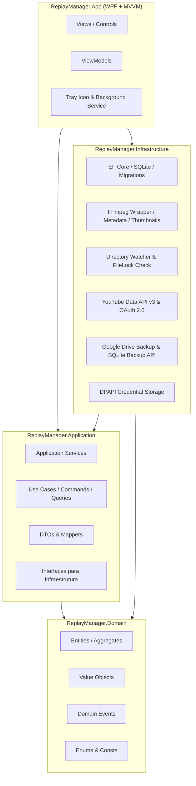
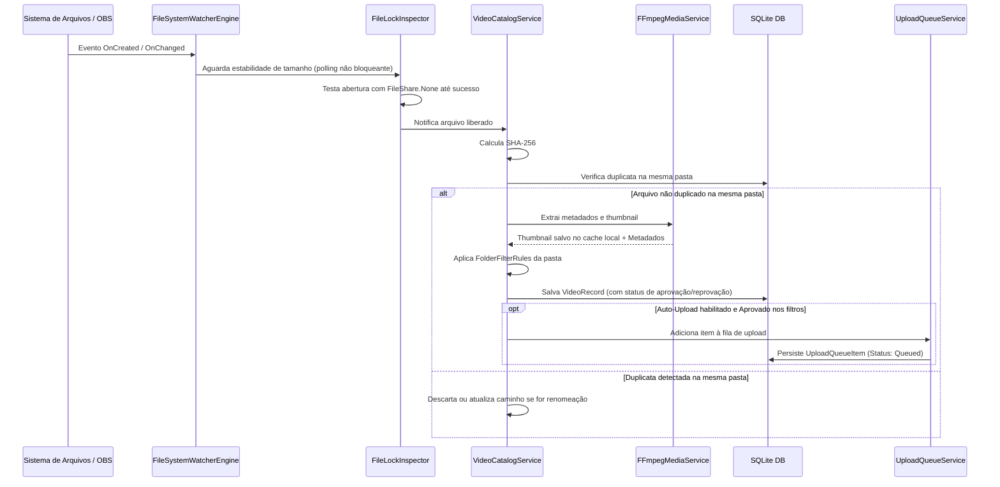
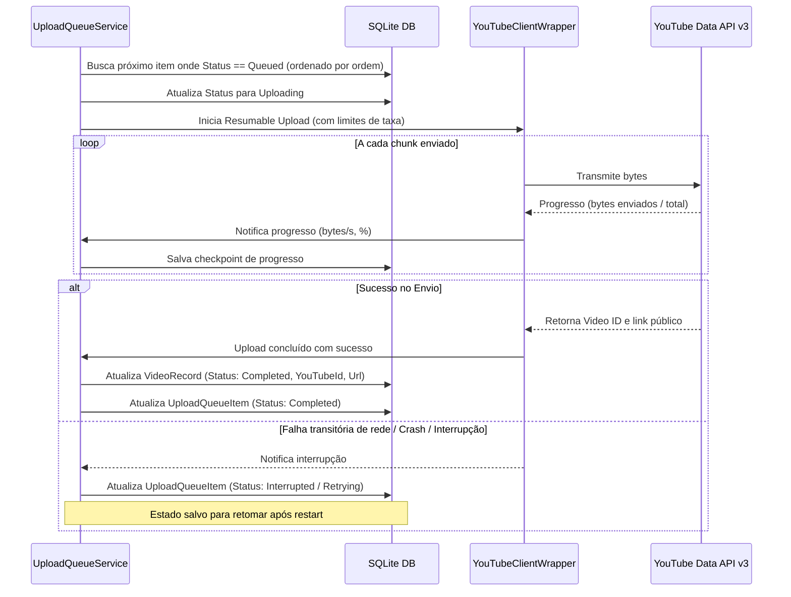

# Architecture: Replay Manager

## 1. Visão Geral da Arquitetura
O **Replay Manager** adota os princípios da **Clean Architecture** combinados com o padrão de apresentação **MVVM (Model-View-ViewModel)**. A arquitetura é desenhada para garantir:
1. **Desacoplamento Total**: O núcleo do domínio e regras de negócio não conhecem WPF, SQLite, Google APIs ou o sistema de arquivos específico.
2. **Testabilidade Isolada**: Todas as fronteiras externas (disco, FFmpeg, APIs de nuvem, banco de dados) são acessadas através de interfaces injetáveis via Injeção de Dependência (DI).
3. **Resiliência a Falhas**: Operações assíncronas longas (como hash de arquivos, análise FFmpeg e upload) rodam em background sem bloquear a UI e com persistência de estado a cada transição crítica.
4. **Continuidade de Sessão**: Cada módulo possui limites estritos para permitir desenvolvimento incremental.

---

## 2. Diagrama de Camadas

---

## 3. Divisão dos Projetos e Responsabilidades

### 3.1. `ReplayManager.Domain`
- **Responsabilidade**: Contém os conceitos de negócio puros, entidades e regras invariantes.
- **Dependências externas**: Zero (apenas BCL/.NET padrão).
- **Entidades Principais**:
  - `MonitoredFolder`: Pasta monitorada com suas regras de filtro e auto-upload.
  - `FolderFilterRule`: Regras de filtragem por extensão, tamanho (min/max), duração (min/max), subpastas, regex de nome.
  - `VideoRecord`: Registro canônico do vídeo, metadados (resolução, duração, bitrate), hash SHA-256 local, caminhos, situação local e situação remota.
  - `UploadQueueItem`: Item na fila de envio, status de progresso, bytes transferidos, velocidade, tentativas, erro e link resultante.
  - `YouTubeAccount`: Estado de autenticação da conta, channel ID, channel title, data de concessão de token.
  - `DescriptionTemplate`: Template com marcadores para geração de descrição.
- **Enums**:
  - `LocalFileStatus`: `Available`, `Missing`, `LockedInRecording`, `Corrupted`.
  - `UploadStatus`: `None`, `Queued`, `Preparing`, `Uploading`, `Paused`, `Interrupted`, `Failed`, `Completed`.
  - `YouTubePrivacyStatus`: `Unlisted` (padrão), `Private`, `Public`.
  - `FilterEvaluationStatus`: `Approved`, `RejectedByMinSize`, `RejectedByMaxSize`, `RejectedByMinDuration`, `RejectedByMaxDuration`, `RejectedByExtension`, `RejectedByNamePattern`.

### 3.2. `ReplayManager.Application`
- **Responsabilidade**: Casos de uso da aplicação, orquestração de fluxos e validações.
- **Principais Componentes**:
  - `IMonitoredFolderService`: Gestão de pastas cadastradas, acionamento de reconciliação manual/automática.
  - `IVideoCatalogService`: Consulta, paginação, filtros, pesquisa e ordenação de vídeos na biblioteca.
  - `IUploadQueueService`: Enfileiramento, pausa, cancelamento, reordenação e retry de uploads.
  - `IVideoAnalysisService`: Orquestração de cálculo de hash e extração de thumbnail/metadados.
  - `IYouTubeService`: Contrato para autenticação, verificação de canal, upload retomável e edição de metadados.
  - `IBackupService`: Contrato para criação de backup SQLite consistente e upload no Google Drive.
  - `ISystemSettingsService`: Preferências globais (comportamento de fechamento, limite de velocidade, inicialização com Windows).

### 3.3. `ReplayManager.Infrastructure`
- **Responsabilidade**: Implementações concretas de I/O, banco de dados, rede e bibliotecas nativas.
- **Principais Componentes**:
  - `ReplayManagerDbContext`: DbContext SQLite com configuração Fluent API e histórico de migrações.
  - `FileSystemWatcherEngine`: Monitoramento nativo via `FileSystemWatcher` com debounce, verificação de estabilidade de gravação (tentativa de leitura sem lock com intervalo configurável) e rotina periódica de varredura (polling de reconciliação) para compensar buffers cheios do OS.
  - `FFmpegMediaService`: Process execution do FFmpeg para extrair frame e capturar duração/resolução sem travar a aplicação.
  - `YouTubeClientWrapper`: Implementação utilizando `Google.Apis.YouTube.v3` e `ResumableUpload<T>` com reporte de progresso granular.
  - `SqliteBackupEngine`: Utilização de `sqlite3_backup` ou `Microsoft.Data.Sqlite` para clonar o banco ativo em estado consistente atômico.
  - `DpapiDataProtector`: Criptografia de tokens de refresh e credenciais com `ProtectedData.Protect` (`DataProtectionScope.CurrentUser`).

### 3.4. `ReplayManager.App`
- **Responsabilidade**: Interface de usuário WPF, views, estilos XAML, ViewModels e integração com a bandeja do sistema (Tray Icon).
- **Padrão**: MVVM com `CommunityToolkit.Mvvm` (`ObservableObject`, `RelayCommand`, `WeakReferenceMessenger`).
- **Navegação**: ShellWindow com menu lateral e áreas dedicadas:
  1. **Biblioteca**: Grid de miniaturas, cards de vídeo com badges visuais de estado, barra de busca e filtros, visualizador de detalhes lateral.
  2. **Fila de Upload**: Lista sequencial, progresso detalhado de bytes/segundo, botões de pausa/retomada/reordenação.
  3. **Pastas Monitoradas**: Gerenciamento de diretórios, regras por pasta, status de varredura.
  4. **YouTube**: Painel de login/logout, informações do canal, modelos de descrição.
  5. **Backup & Nuvem**: Histórico de backups, botão de backup imediato e restauração.
  6. **Configurações & Logs**: Opções de inicialização, comportamento de fechamento de janela (Opção C), throttling de banda, visualizador e exportador de logs.

### 3.5. `ReplayManager.Tests`
- **Responsabilidade**: Testes automatizados cobrindo:
  - Avaliação de regras de filtro de vídeo (Domain).
  - Deduplicação intra-pasta e isolamento inter-pastas (Application & Persistence).
  - Serialização de estado da fila de upload (Application & Infrastructure).
  - Geração de títulos e modelos de descrição.
  - Tratamento de locks de gravação de arquivos novos.

---

## 4. Fluxos de Dados Críticos

### 4.1. Detecção e Ingestão de Vídeo Novo

### 4.2. Execução da Fila de Upload Resiliente

---

## 5. Decisões Técnicas Estruturantes
1. **Deduplicação Restrita à Pasta**: Arquivos idênticos em pastas diferentes são cadastrados como vídeos independentes. Dentro da mesma pasta, arquivos com o mesmo SHA-256 são tratados como duplicatas.
2. **Nenhuma Exclusão Automática**: O Replay Manager nunca invoca `File.Delete` em arquivos de vídeo do usuário.
3. **Persistência First na Fila**: Qualquer transição de estado da fila é imediatamente comitada no SQLite com transação antes de disparar o evento na UI.
4. **Resumable Upload do YouTube**: Uploads utilizam streaming em chunks, permitindo retomar de onde parou em caso de queda de conexão.
5. **Comportamento de Fechamento (Opção C)**: Janela modal de escolha ao fechar:
   - Minimizar para bandeja e continuar executando.
   - Fechar janela mantendo serviço de background.
   - Encerrar completamente (com aviso se houver upload ativo e garantia de cancelamento limpo com persistência de checkpoint).
