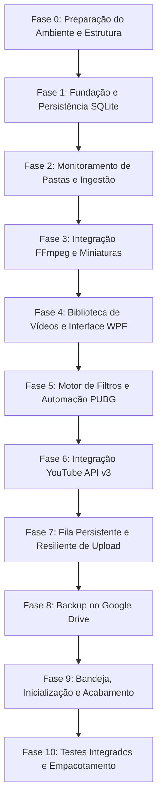

# Implementation Plan: Replay Manager

Este plano descreve o roteiro de desenvolvimento em 11 fases estruturadas, respeitando o princípio de desenvolvimento modular, testes e continuidade entre sessões.

---

## Matriz de Fases e Dependências

---

## Detalhamento das Fases

### Fase 0 — Preparação do Ambiente e Estrutura (EM ANDAMENTO NA SESSÃO ATUAL)
- **Objetivo**: Garantir que o ambiente possua os SDKs necessários, repositório Git limpo, documentação de continuidade viva, solução .NET criada com a arquitetura definida e compilação sem erros.
- **Tarefas**:
  - [x] Avaliar especificações e riscos técnicos.
  - [x] Inicializar Git e `.gitignore`.
  - [x] Configurar .NET 10 SDK no ambiente.
  - [ ] Criar solução `ReplayManager.sln` com os projetos:
    - `ReplayManager.Domain` (ClassLib, net10.0)
    - `ReplayManager.Application` (ClassLib, net10.0)
    - `ReplayManager.Infrastructure` (ClassLib, net10.0-windows)
    - `ReplayManager.App` (WinExe WPF, net10.0-windows)
    - `ReplayManager.Tests` (xUnit, net10.0)
  - [ ] Configurar referências entre os projetos.
  - [ ] Gerar documentação completa de continuidade (`PROJECT_CONTEXT.md`, `ARCHITECTURE.md`, `IMPLEMENTATION_PLAN.md`, `DEVELOPMENT_STATUS.md`, `DECISIONS.md`, `TESTING.md`, `SESSION_LOG.md`, `CHANGELOG.md`, `NEXT_SESSION.md`).
  - [ ] Compilar solução inicial com `dotnet build` e validar saída.
- **Critério de Aceite**: Solução criada e compilando com zero erros e warnings críticos; documentos criados e git commit inicial realizado.

---

### Fase 1 — Fundação e Persistência SQLite
- **Objetivo**: Modelar as entidades do domínio e persistência com EF Core e SQLite.
- **Tarefas**:
  - [ ] Implementar entidades do Domínio: `VideoRecord`, `MonitoredFolder`, `FolderFilterRule`, `UploadQueueItem`, `YouTubeAccount`, `DescriptionTemplate`.
  - [ ] Configurar `ReplayManagerDbContext` com Fluent API, chaves, índices e restrições de integridade.
  - [ ] Configurar conexão SQLite com WAL mode habilitado para performance e integridade de concorrência.
  - [ ] Implementar repositórios ou Unit of Work para persistência segura com transações.
  - [ ] Configurar sistema de logging estruturado (Microsoft.Extensions.Logging / Serilog).
  - [ ] Criar testes unitários e de integração em memória/SQLite temporário para validação de integridade.
- **Critério de Aceite**: Banco criado, migrations aplicadas e testes de CRUD persistente executados com sucesso.

---

### Fase 2 — Monitoramento de Pastas e Ingestão
- **Objetivo**: Gerenciar diretórios cadastrados, detectar novos vídeos e identificar término de gravações.
- **Tarefas**:
  - [ ] Implementar serviço de monitoramento com `FileSystemWatcher`.
  - [ ] Desenvolver `FileStabilityChecker`: rotina assíncrona que monitora o tamanho do arquivo ao longo do tempo e tenta abrir com `FileAccess.Read` / `FileShare.None` para assegurar que o software de gravação terminou de escrever.
  - [ ] Implementar cálculo de hash SHA-256 em streaming assíncrono.
  - [ ] Implementar regra de deduplicação estrita: mesmo hash dentro da mesma pasta monitorada é tratado como duplicata; arquivos iguais em pastas diferentes são registrados separadamente.
  - [ ] Implementar motor de reconciliação periódica (timer) para verificar arquivos novos ou renomeados perdidos por estouro de buffer do OS.
  - [ ] Testes automatizados com criação assíncrona de arquivos falsos simulando gravação ativa.
- **Critério de Aceite**: Detecção e estabilização de arquivos validadas sem falsos positivos de arquivos em gravação.

---

### Fase 3 — Integração FFmpeg e Miniaturas
- **Objetivo**: Extrair propriedades técnicas de vídeo e gerar miniaturas visuais.
- **Tarefas**:
  - [ ] Localizar ou gerenciar binário do FFmpeg (suporte a executável local ou PATH).
  - [ ] Implementar serviço de extração de metadados (duração em segundos, resolução width x height, bitrate, codec de vídeo).
  - [ ] Implementar captura de thumbnail em timestamp seguro (ex: 15% da duração ou timestamp configurável) para evitar telas pretas iniciais de gravação.
  - [ ] Armazenamento organizado das miniaturas em pasta dedicada (`AppData/Thumbnails`) com nomes baseados em hash ou ID do vídeo.
  - [ ] Suporte à substituição manual de thumbnail pelo usuário.
  - [ ] Testes unitários do parser de saída do FFprobe/FFmpeg.
- **Critério de Aceite**: Vídeos de teste processados com duração correta e thumbnail gerada e salva no cache.

---

### Fase 4 — Biblioteca de Vídeos e Interface WPF
- **Objetivo**: Construir a visualização primária do usuário com alta responsividade.
- **Tarefas**:
  - [ ] Implementar casca visual principal (ShellWindow) com navegação fluida em abas/seções.
  - [ ] Desenvolver `LibraryViewModel` e `LibraryView`: Grade de miniaturas virtualizada (VirtualizingWrapPanel / ListView moderno).
  - [ ] Exibir badges de status visual nos cards (Apenas Local, Na Fila, Enviado, Local Indisponível).
  - [ ] Implementar barra de busca em tempo real por nome/data e filtros rápidos de status.
  - [ ] Implementar painel lateral de detalhes do vídeo selecionado.
  - [ ] Implementar lógica de reprodução: detectar VLC instalado no registro ou diretórios comuns; caso ausente, chamar `Process.Start` para o player padrão do Windows.
  - [ ] Identificação visual clara de arquivos apagados no disco (sem apagar os metadados do banco).
- **Critério de Aceite**: Grade navegável, responsiva com rolagem suave, busca rápida e acionamento de reprodução local funcional.

---

### Fase 5 — Motor de Filtros e Automação PUBG
- **Objetivo**: Permitir regras customizadas por pasta e automatizar envio para PUBG.
- **Tarefas**:
  - [ ] Implementar avaliador de regras de filtro `FilterEvaluator`:
    - Extensão (.mp4, .mkv, .avi)
    - Tamanho mínimo (default 10 MB) e máximo (default 100 MB, desativável)
    - Duração mínima e máxima
    - Regex / Padrões de nome
    - Opção de incluir subpastas
  - [ ] Registrar o motivo detalhado em caso de reprovação nos filtros.
  - [ ] Configuração de auto-upload para pasta específica (ex: Replays do PUBG).
  - [ ] Fluxo automático: após gravação concluída e metadados extraídos, se aprovado, enfileirar imediatamente. Se reprovado, manter na biblioteca com motivo.
  - [ ] Testes unitários com matriz completa de combinações de filtros.
- **Critério de Aceite**: Arquivos fora dos limites rejeitados com motivo documentado no registro; arquivos válidos enfileirados automaticamente.

---

### Fase 6 — Integração YouTube API v3
- **Objetivo**: Autenticação Google e upload confiável com controle de privacidade.
- **Tarefas**:
  - [ ] Investigação aprofundada de requisitos da API do YouTube (projetos unverified e escopos `youtube.upload`).
  - [ ] Implementar fluxo OAuth 2.0 (GoogleWebAuthorizationBroker / Custom loopback redirect) com credenciais salvas de forma segura via Windows DPAPI.
  - [ ] Interface de status da conta: exibe nome do canal, ID do canal, thumbnail da conta e botão de desconectar.
  - [ ] Implementar gerador de títulos automáticos (`PUBG Replay - DD/MM/AAAA - HH:MM:SS`) extraindo timestamp do arquivo ou nome original.
  - [ ] Implementar templates de descrição com variáveis dinâmicas.
  - [ ] Implementar upload resumable via `ResumableUpload<Video>` com tratamento de privacidade padrão "Não listado" (`unlisted`).
  - [ ] Ação explícita "Salvar alterações no YouTube" (`videos.update`) para atualizar títulos e descrições sem sobrescrever outros metadados.
- **Critério de Aceite**: Autenticação funcional, upload de vídeo de teste concluído com URL retornado e salvo no banco.

---

### Fase 7 — Fila Persistente e Resiliente de Upload
- **Objetivo**: Orquestrar a fila de uploads com garantia de sobrevivência a interrupções.
- **Tarefas**:
  - [ ] Serviço de fila singleton: processamento estritamente sequencial (1 upload por vez na v1).
  - [ ] Transições de estado da fila persistidas imediatamente no SQLite.
  - [ ] Implementação de Throttling de velocidade de upload (limitador de taxa de envio de bytes em streaming).
  - [ ] Retomada de uploads interrompidos (gravação de `UploadUri` do resumable upload para retomar do byte exato).
  - [ ] Reconciliação preventiva para evitar reenvio de vídeo já inserido.
  - [ ] Comandos de UI para pausar, retomar, reordenar, remover da fila e retry manual.
- **Critério de Aceite**: Simulação de crash ou encerramento no meio do envio; após reiniciar, a fila retoma o upload de onde parou.

---

### Fase 8 — Backup no Google Drive
- **Objetivo**: Proteger o catálogo SQLite contra perda de dados.
- **Tarefas**:
  - [ ] Implementar clonagem atômica do SQLite em tempo de execução via `SqliteConnection.BackupDatabase` (sem lock que impeça o uso normal).
  - [ ] Integração com Google Drive API v3 (pasta do aplicativo ou AppData folder no Drive).
  - [ ] Versionamento e retenção dos últimos N backups configurável.
  - [ ] Rotina de verificação de integridade pós-upload (`PRAGMA integrity_check` no arquivo antes de enviar).
  - [ ] Mecanismo de restauração com prompt de confirmação explícito.
- **Critério de Aceite**: Backup consistente gerado e enviado ao Google Drive; teste de integridade validado.

---

### Fase 9 — Bandeja, Inicialização e Acabamento
- **Objetivo**: Polimento operacional do aplicativo como serviço desktop contínuo.
- **Tarefas**:
  - [ ] Notificação na bandeja do sistema (NotifyIcon / Hardcodet.NotifyIcon.Wpf) com menu de contexto.
  - [ ] Opção C ao clicar no botão "X" de fechar:
    1. Minimizar para bandeja e continuar.
    2. Fechar janela e manter serviço.
    3. Encerrar completamente (com verificação de uploads ativos).
  - [ ] Configuração para iniciar com o Windows (chave Run do Registro ou atalho de inicialização).
  - [ ] Notificações Toast nativas do Windows para uploads concluídos ou com falha.
  - [ ] Exportação da biblioteca para CSV e JSON.
  - [ ] Painel e exportação de logs técnicos (sem expor credenciais).
- **Critério de Aceite**: Fechamento Opção C operando perfeitamente; app rodando em background na bandeja; exportações gerando arquivos válidos.

---

### Fase 10 — Validação e Distribuição
- **Objetivo**: Homologação completa, estabilidade sob estresse e pacote de distribuição.
- **Tarefas**:
  - [ ] Testes de carga com arquivos grandes (>5GB) e arquivos inválidos/corrompidos.
  - [ ] Teste de perda e retorno de conexão de rede durante upload.
  - [ ] Teste de sobrevivência a reinicialização forçada do sistema.
  - [ ] Publicação do aplicativo no formato Single-File ou Self-Contained.
  - [ ] Criação de documentação de usuário final e guia de configuração das credenciais Google.
- **Critério de Aceite**: Aplicação estável, sem memory leaks nem travamentos na UI, pronta para uso em produção.

